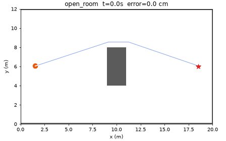
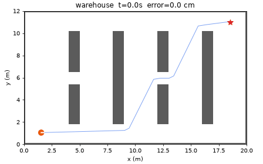
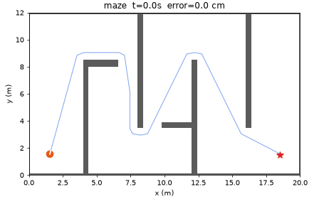
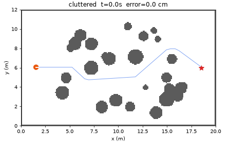
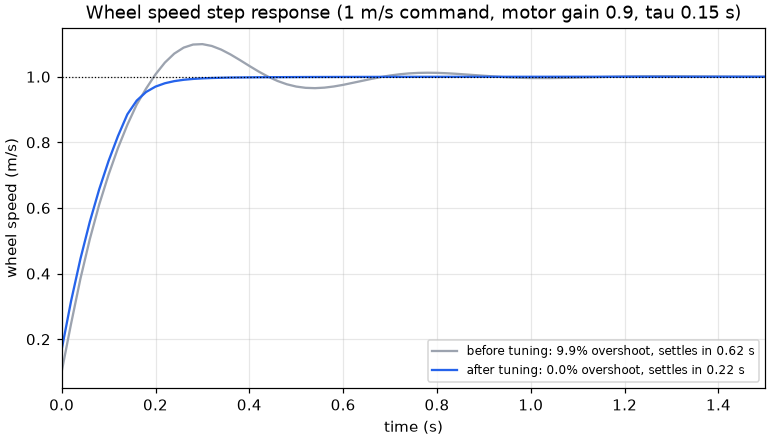
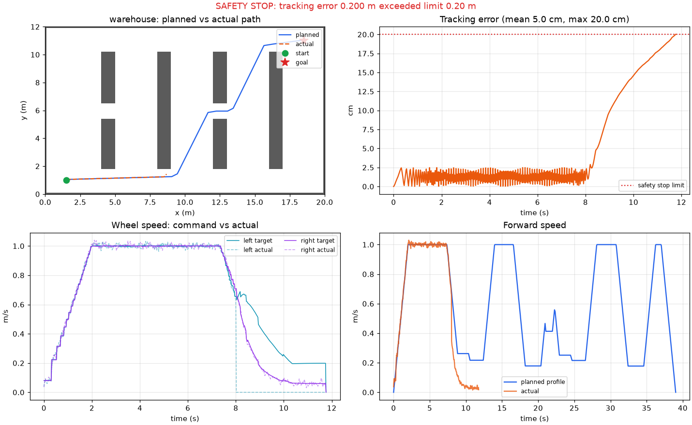
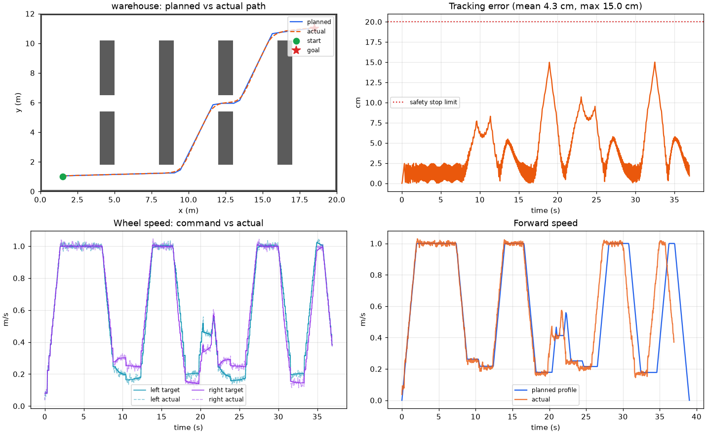

# Mobile Robot Path Planner

A Python simulation of a differential-drive robot. It plans a collision-free path
with A* on an occupancy grid, turns the path into a speed-limited trajectory,
and follows it with a pure pursuit controller. Each wheel's speed is closed-loop
controlled by a PID on a first-order motor model with noise. A safety supervisor
stops the robot if it drifts too far from the plan.

| open_room | warehouse |
|---|---|
|  |  |
| **maze** | **cluttered** |
|  |  |

## Pipeline

```
occupancy grid ──inflate by robot radius + margin──▶ A* (8-connected, Euclidean heuristic)
      ──▶ line-of-sight shortcut + Chaikin corner rounding (kept only if collision free)
      ──▶ trajectory: v_max, a_max, lateral-accel limit on curvature, forward/backward pass
      ──▶ pure pursuit (speed-dependent lookahead) ──▶ left/right wheel speed targets
      ──▶ PID per wheel ──▶ first-order motor (lag, gain error, noise) ──▶ diff-drive kinematics
      ──▶ safety supervisor: tracking error limit + footprint collision check
```

| Module | What it does |
|---|---|
| `maps.py` | 4 maps, 20 x 12 m at 0.1 m/cell: open room, warehouse aisles, maze, seeded random clutter. Obstacle inflation. |
| `astar.py` | A* written from scratch. Straight moves cost 1 and diagonals cost √2, with no corner cutting. The Euclidean heuristic is admissible, so paths are optimal on the grid. |
| `smoothing.py` | Exact grid traversal (Amanatides–Woo) for line of sight, greedy shortcutting, Chaikin rounding, resampling |
| `trajectory.py` | Arc length, Menger curvature, speed cap from `sqrt(a_lat / κ)`, acceleration-limited forward/backward passes, time stamps |
| `models.py` | `Motor`: first-order lag `τ = 0.15 s`, 0.9 gain (delivers 90% of the command), Gaussian noise, stuck-wheel fault. `DiffDrive`: exact arc integration. |
| `pid.py` | PID with feedforward, derivative on measurement (no setpoint kick), anti-windup by conditional integration |
| `pure_pursuit.py` | Forward-only progress search, lookahead `0.4 + 0.6·v` clamped to 1.5 m, `κ = 2 sin α / L`, slows when heading error is large, preserves curvature when a wheel saturates |
| `safety.py` | Commands zero speed and logs the reason when tracking error > 0.2 m or the footprint touches an obstacle |
| `sim.py` | 50 Hz closed loop, logs every signal |

## Results

`python -m robot_sim benchmark --seeds 5` (5 noise seeds per map):

| Map | Path length | Mean tracking error | Max tracking error | Reached goal |
|---|---|---|---|---|
| open_room | 17.8 m | 1.7 cm | 5.7 cm | 5/5 |
| warehouse | 22.7 m | 4.3 cm | 15.2 cm | 5/5 |
| maze | 35.7 m | 3.9 cm | 15.2 cm | 5/5 |
| cluttered | 19.2 m | 3.7 cm | 12.0 cm | 5/5 |

The largest errors are at sharp corners, where pure pursuit cuts inside the
turn. They stay below the 20 cm safety limit on every run.

### PID tuning



The wheel speed loop was tuned on a 1 m/s step into the motor model. The
starting gains (P = 0.3, I = 30, no feedforward) rely almost entirely on the
integral term and overshoot. `python -m robot_sim tune` grid-searches P and I
with velocity feedforward, picking the fastest-settling pair with under 2%
overshoot.

| | Overshoot | Settling time (2%) |
|---|---|---|
| Before (P 0.3, I 30) | 9.9% | 0.62 s |
| After (P 2.8, I 16, feedforward) | 0.0% | 0.22 s |

Better wheel tuning barely changes path tracking error: within 0.1 cm on every
map in the benchmark. At these speeds, path tracking is dominated by pure
pursuit geometry, not by wheel response.

### Safety stop

`python -m robot_sim run --map warehouse --stuck-wheel-at 8` locks the left wheel
8 s into the run. The robot starts to curve off the path, the supervisor sees the
tracking error pass 0.2 m, commands zero speed and logs the reason. The stop
limit (0.2 m) is set below the planner's extra clearance (0.2 m beyond the robot
radius), so the robot stops before its footprint can reach an obstacle.



## Plots per run

`python -m robot_sim run --map maze --plot out/maze.png` shows planned vs actual
path, tracking error over time, wheel speed command vs actual, and planned vs
actual forward speed.



## Install and run

```bash
python -m venv .venv
source .venv/bin/activate          # Windows: .venv\Scripts\activate
pip install -r requirements.txt

python -m robot_sim run --map warehouse --plot out/warehouse.png --gif out/warehouse.gif
python -m robot_sim run --map warehouse --untuned        # pre-tuning gains
python -m robot_sim run --map warehouse --stuck-wheel-at 8
python -m robot_sim benchmark --seeds 5 --plot-step out/pid_step.png
python -m robot_sim tune
pytest -v
```

## Tests

57 pytest tests, including:

- **A\***: on 15 random grids its cost equals Dijkstra's (zero heuristic) with no more node expansions. Also checked: no corner cutting, unreachable goals, starts inside obstacles.
- **Smoothing**: grid traversal catches a segment that only clips a cell corner, and every map's smoothed path is collision free and no longer than the A* path.
- **Trajectory**: starts and ends at rest, never exceeds v_max or a_max, slows for corners, and matches the analytic trapezoid time on a straight line.
- **Models**: motor reaches 63% of the step at t = τ, gain and saturation, stuck wheel, exact straight, spin and quarter-circle kinematics.
- **PID**: removes steady-state error from the weak motor, tuning reduces overshoot and settling time, anti-windup, no derivative kick.
- **Pure pursuit**: converges back onto a line from a 0.3 m offset, turns the right way, lookahead scales with speed.
- **Whole loop**: reaches the goal on every map with error under the limit, the stuck-wheel fault stops the robot without the footprint touching an obstacle, and runs are reproducible per seed.

## Possible extensions

- Move the PID and pure pursuit controller into a Rust crate called from Python.
- Split planner, controller and simulated robot into ROS 2 nodes and view them in RViz.
